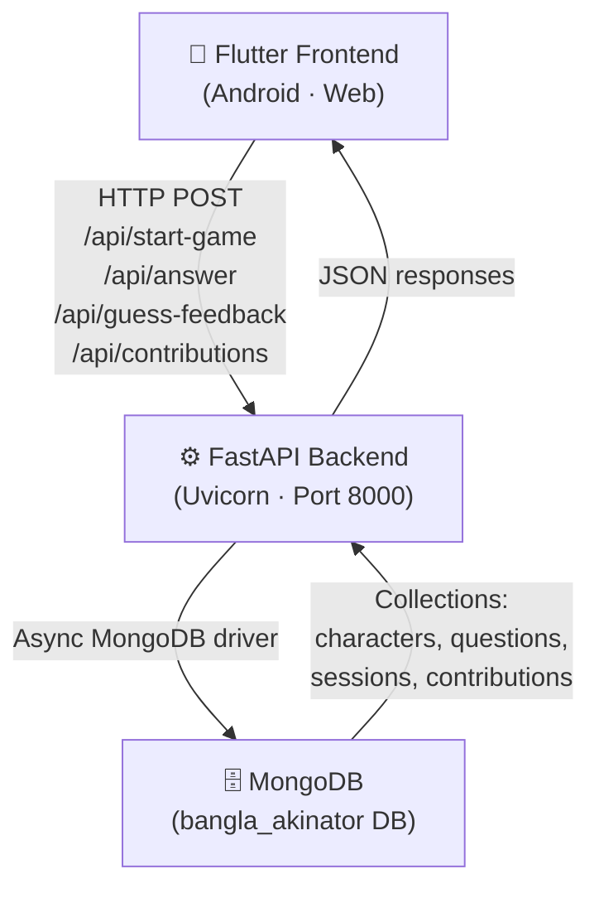
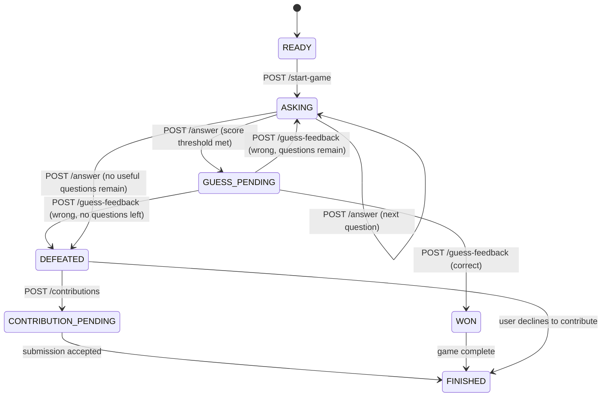
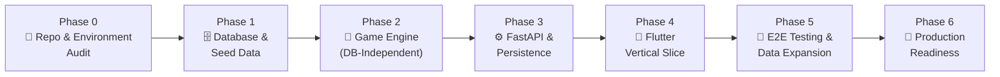

# 🧞 Bangla Akinator — Revised Build Plan V2

**Document status:** Updated after adversarial technical review
**Product:** বাংলা জ্বিন (Bangla Akinator)
**Primary V1 target:** Android first, Flutter Web for dev/testing
**Backend:** Python 3.11+ / FastAPI
**Database:** MongoDB (async driver — evaluate PyMongo async vs Motor before implementation)
**Frontend state management:** Flutter Riverpod (no Provider ambiguity)

---

## Goal Description

Build a **Bangla Akinator** — a guessing game that uses **categorical likelihood scoring**, **expected information gain** question selection, and a **moderated contribution pipeline** to guess Bangla (Bangladeshi) personalities. The original plan has been revised to fix scoring correctness, complete the game state machine, persist sessions, validate contributions, and add proper automated testing.



---

## Locked Decisions (from Review)

These are **resolved** — no longer open questions.

| Decision | Resolution | Reason |
|---|---|---|
| Initial scope | Bangladeshi personalities with labelled categories | Coherent seed data; add global figures later |
| Launch dataset | 100–150 verified characters; develop with 10–20 | Quality > quantity |
| Platforms | Android primary; Web for dev/secondary | iOS deferred until signing/testing addressed |
| State management | **Riverpod only** | No Provider/Riverpod ambiguity |
| Session persistence | **MongoDB-backed with TTL expiry** | Survives restart, multi-worker compatible |
| Learning policy | Contributions are **pending_review**, not auto-trusted | Prevents spam, duplicates, low-quality data |
| Images | Optional URL; use licensed assets or omit | Avoid broken hotlinks and rights issues |
| Score display | Show "best match" or score indicator, NOT "confidence %" | Scores aren't calibrated probabilities |
| Deployment | One documented path first; Docker recommended | No untested multi-path confusion |
| Database driver | Evaluate async PyMongo API vs Motor before coding | Use what's currently officially supported |
| Flutter project name | `akinator_frontend` | Matches existing directory |

---

## V1 Scope Boundaries

### Must Have
- Start game and receive a question
- Submit one of five answer options (YES, PROBABLY_YES, UNKNOWN, PROBABLY_NO, NO)
- Select next question via expected information gain, or present a guess
- Confirm a correct guess (`POST /api/guess-feedback`)
- Reject an incorrect guess and continue or finish
- Submit a missing character with validation and duplicate detection
- Persist session state; expire abandoned sessions
- Bengali Unicode text support and clear error messages
- Comprehensive automated test suite (engine unit tests, API integration tests, Flutter widget tests)

### Deferred (Can Wait)
- Popularity boosts, complex weight decay, badges, leaderboards
- Redis (unless MongoDB sessions prove inadequate under load)
- Auto-acceptance of community-submitted character facts
- iOS builds
- Real-time analytics, multi-language UI, advanced animations
- Fabricated statistics ("Only 2% beat the Genie today!")

---

## Architecture & Repository Layout

```text
bangla_akinator/
├── akinator_backend/
│   ├── app/
│   │   ├── __init__.py
│   │   ├── main.py                    # FastAPI app, lifespan, CORS
│   │   ├── api/
│   │   │   ├── __init__.py
│   │   │   ├── router.py             # API route handlers (renamed from endpoints.py)
│   │   │   └── schemas.py            # Pydantic request/response models
│   │   ├── core/
│   │   │   ├── __init__.py
│   │   │   ├── config.py             # Pydantic Settings
│   │   │   ├── database.py           # Async DB client lifecycle
│   │   │   ├── logging_config.py     # Structured logging setup
│   │   │   └── errors.py             # Common error response format
│   │   ├── models/
│   │   │   ├── __init__.py
│   │   │   └── domain.py             # Domain enums, answer types, game states
│   │   ├── repositories/
│   │   │   ├── __init__.py
│   │   │   ├── characters.py         # Character DB operations
│   │   │   ├── questions.py          # Question DB operations
│   │   │   └── sessions.py           # Session persistence + TTL
│   │   └── services/
│   │       ├── __init__.py
│   │       ├── game_engine.py         # Scoring, state machine, candidate ranking
│   │       ├── question_selection.py  # Expected information gain calculation
│   │       └── contribution_service.py # Validate, deduplicate, store contributions
│   ├── scripts/
│   │   ├── seed_data.py              # Idempotent seed script
│   │   └── validate_seed_data.py     # Data quality checker
│   ├── tests/
│   │   ├── conftest.py               # Shared fixtures, test DB
│   │   ├── unit/                     # Engine, scoring, question selection
│   │   └── integration/              # API endpoint tests
│   ├── .env.example                  # Template (never commit actual .env)
│   ├── .gitignore
│   ├── requirements.txt
│   └── README.md
├── akinator_frontend/
│   ├── lib/
│   │   ├── main.dart                 # Entry point
│   │   ├── app.dart                  # MaterialApp + Riverpod setup
│   │   ├── core/
│   │   │   ├── config/               # API URL config per environment
│   │   │   ├── errors/               # Error types and handling
│   │   │   └── theme/                # Bangla typography, colors
│   │   ├── models/                   # Data classes
│   │   ├── repositories/             # API communication layer
│   │   ├── providers/                # Riverpod state providers
│   │   ├── screens/                  # UI screens
│   │   └── widgets/                  # Reusable components
│   ├── test/                         # Unit + widget tests
│   ├── integration_test/             # E2E tests
│   ├── .env.example
│   └── pubspec.yaml
├── docs/
│   ├── API_CONTRACT.md               # Full API specification
│   ├── DATA_MODEL.md                 # MongoDB schema documentation
│   └── DEPLOYMENT.md                 # Deployment guide
├── AGENTS.md                         # AI agent coding rules
├── SPEC.md                           # Project specification
├── README.md
└── .gitignore
```

> [!IMPORTANT]
> **Key structural changes from V1 plan:**
> - `endpoints.py` → renamed to `router.py` (clearer intent)
> - New `repositories/` layer separating DB access from business logic
> - New `models/domain.py` for enums, answer types, game states
> - New `services/question_selection.py` (separated from game_engine)
> - New `services/contribution_service.py` (moderation pipeline)
> - New `core/logging_config.py` and `core/errors.py`
> - New `scripts/validate_seed_data.py`
> - New `tests/` directory with unit + integration subdirs
> - Frontend adds `app.dart`, `repositories/`, `core/config/`, `core/errors/`, test dirs
> - New `docs/` directory with API_CONTRACT, DATA_MODEL, DEPLOYMENT

### Architectural Rules

- Keep HTTP handling, game logic, and database access in **separate layers**
- Use typed Pydantic request/response schemas for all endpoints
- Use **async** database calls; never block the event loop
- Create and close the DB client through **FastAPI lifespan** (not module-level globals)
- Keep secrets in `.env` / secret manager; never commit `.env`
- Make API base URL configurable per build/environment
- Pin dependencies to tested compatible versions
- Keep game-engine logic **testable without a live database**
- Use repository functions for all database operations

---

## Domain Model & Data Quality

### Character Document (`characters` collection)

```json
{
  "_id": "ObjectId",
  "name_bn": "সাকিব আল হাসান",
  "name_en": "Shakib Al Hasan",
  "normalized_name": "সাকিব আল হাসান",
  "aliases_bn": [],
  "aliases_en": ["Shakib"],
  "categories": ["ক্রিকেটার", "ক্রীড়াবিদ"],
  "is_real_person": true,
  "is_alive": true,
  "answer_profile": {
    "q_is_real_person": {
      "value": true,
      "confidence": 1.0,
      "source": "editor_verified"
    },
    "q_is_cricketer": {
      "value": true,
      "confidence": 1.0,
      "source": "editor_verified"
    },
    "q_is_writer": {
      "value": false,
      "confidence": 1.0,
      "source": "editor_verified"
    }
  },
  "image_url": null,
  "image_attribution": null,
  "status": "published",
  "created_at": "UTC datetime",
  "updated_at": "UTC datetime",
  "times_played": 0,
  "times_guessed_correctly": 0
}
```

> [!IMPORTANT]
> **Key schema changes from V1:**
> - `categories: []` (array) instead of single `category: string` — a person can be singer AND actor
> - `answer_profile` stores **verified boolean facts** with confidence and provenance, NOT raw floats
> - `normalized_name` + `aliases_bn/en` for duplicate detection
> - `status` field (`published` / `pending_review` / `rejected`)
> - Timestamps for audit trail
> - Analytics counters (`times_played`, `times_guessed_correctly`) updated atomically

### Question Document (`questions` collection)

```json
{
  "_id": "ObjectId",
  "question_code": "q_is_cricketer",
  "text_bn": "এই ব্যক্তি কি ক্রিকেটার?",
  "text_en": "Is this person a cricketer?",
  "answer_type": "boolean",
  "active": true,
  "order": 10,
  "created_at": "UTC datetime",
  "updated_at": "UTC datetime"
}
```

> [!NOTE]
> Use **stable, descriptive question codes** (e.g., `q_is_cricketer`) instead of sequential numbers (`q1`, `q2`). This makes seed data, answer profiles, and debugging much more readable.

### Session Document (`sessions` collection)

```json
{
  "_id": "ObjectId",
  "session_id": "cryptographically-random-opaque-id",
  "status": "asking",
  "asked_question_codes": ["q_is_real_person", "q_is_cricketer"],
  "answer_history": {
    "q_is_real_person": "YES",
    "q_is_cricketer": "PROBABLY_YES"
  },
  "rejected_character_ids": [],
  "question_count": 2,
  "created_at": "UTC datetime",
  "updated_at": "UTC datetime",
  "expires_at": "UTC datetime (TTL)"
}
```

### Contribution Document (`contributions` collection)

```json
{
  "_id": "ObjectId",
  "session_id": "reference-to-game-session",
  "name_bn": "তাশরিফ খান",
  "categories": ["সংগীতশিল্পী"],
  "answer_history": { "q_is_real_person": "YES", "q_is_musician": "YES" },
  "status": "pending_review",
  "created_at": "UTC datetime"
}
```

### Answer Representation (Critical Fix)

> [!CAUTION]
> **The V1 plan conflated two different things using the same 0.0–1.0 float.** The review requires separating them:

| Concept | Type | Values |
|---|---|---|
| **User answer** (what the player clicks) | Enum | `YES`, `PROBABLY_YES`, `UNKNOWN`, `PROBABLY_NO`, `NO` |
| **Character fact** (what the DB stores) | Boolean or null | `true`, `false`, or missing/unknown |

The **likelihood model** bridges these: given a character fact (true/false/unknown), how likely is each user response? This is defined as a configurable lookup table, NOT a distance formula.

### Required Indexes

| Collection | Index | Type |
|---|---|---|
| `questions` | `question_code` | Unique |
| `characters` | `normalized_name` (where status=published) | Unique |
| `characters` | `status` | Standard |
| `sessions` | `session_id` | Unique |
| `sessions` | `expires_at` | TTL |
| `contributions` | `status`, `created_at` | Compound |

---

## Game Engine: Correctness Before Complexity

### Scoring Model (Critical Fix)

> [!CAUTION]
> **The V1 `weight *= max(0.1, 1 - abs(expected - user_answer))` heuristic is replaced.** It was an ad-hoc similarity score mislabeled as Bayesian. The review mandates a proper categorical likelihood model.

**V2 approach — Categorical Likelihood with Log-Scores:**

```python
# Configurable likelihood table — P(user_answer | character_fact)
# These are tunable product parameters, not mathematical constants
LIKELIHOOD_TABLE = {
    # (character_fact, user_answer) → likelihood
    (True,  "YES"):          0.90,
    (True,  "PROBABLY_YES"): 0.70,
    (True,  "UNKNOWN"):      0.30,
    (True,  "PROBABLY_NO"):  0.10,
    (True,  "NO"):           0.05,

    (False, "YES"):          0.05,
    (False, "PROBABLY_YES"): 0.10,
    (False, "UNKNOWN"):      0.30,
    (False, "PROBABLY_NO"):  0.70,
    (False, "NO"):           0.90,

    # Unknown/missing fact → neutral (low information)
    (None,  "YES"):          0.20,
    (None,  "PROBABLY_YES"): 0.20,
    (None,  "UNKNOWN"):      0.40,
    (None,  "PROBABLY_NO"):  0.20,
    (None,  "NO"):           0.20,
}
```

**Log-score updates to prevent underflow:**
```text
log_weight[c] += log(likelihood(user_answer | character_fact[c]))
```

Normalize with numerically stable log-sum-exp when posterior distribution is needed.

**Requirements:**
- All likelihoods must be finite and strictly > 0
- Handle empty candidate set as engine error, not silent arbitrary guess
- Deterministic tie-breaking for reproducible tests
- Output is `score` or `match_score`, **NOT** "92% confidence" unless calibrated

### Question Selection (Critical Fix)

> [!CAUTION]
> **The V1 binary yes/no split is replaced.** The UI has 5 answer options, so question selection must account for all 5 possible responses.

**V2 approach — Expected Information Gain:**

```text
information_gain(question)
    = current_entropy(candidates)
      - expected_entropy_after_answer(question)
```

For every candidate question:
1. Estimate probability of each possible user response using current candidate weights + likelihood model
2. Compute expected posterior entropy across all 5 possible responses
3. Subtract expected posterior entropy from current entropy
4. Exclude inactive and already-asked questions
5. Use deterministic tie-breaking
6. Missing character facts → neutral likelihood (not treated as false)

### Game State Machine (Critical Fix)

> [!CAUTION]
> **V1 had incomplete flows — no endpoint for confirming a correct guess, no rejected-guess tracking.** V2 uses an explicit state machine.



**Rules:**
- Never guess before `MIN_QUESTIONS_BEFORE_GUESS` (configurable, default 3) unless only one viable candidate remains
- Guess when top candidate is sufficiently separated from alternatives, OR `MAX_QUESTIONS` reached
- **Rejected guess is excluded from re-guessing** in that session
- After rejected guess, continue with useful unasked questions if possible
- Defeat only when no useful question remains or hard limit reached
- Rejected guess ≠ proof that character's facts are wrong

### Session Persistence

Store in MongoDB `sessions` collection (not in-memory dict):
- `session_id` (cryptographically random, opaque)
- `status` (enum from state machine)
- `asked_question_codes`
- `answer_history`
- `rejected_character_ids`
- `question_count`
- `created_at`, `updated_at`, `expires_at`

> [!IMPORTANT]
> TTL deletion is async — the API must still **reject expired sessions** even if the document hasn't been garbage-collected yet. Validate `expires_at` on every request.

---

## API Contract

### Endpoints

| Method | Path | Purpose |
|---|---|---|
| `GET` | `/health` | Liveness check (no secrets exposed) |
| `GET` | `/ready` | Readiness check including DB availability |
| `POST` | `/api/start-game` | Create persisted session, return first question |
| `POST` | `/api/answer` | Record answer → next question, guess, or defeat |
| `POST` | `/api/guess-feedback` | **[NEW]** Confirm or reject the current guess |
| `POST` | `/api/contributions` | **[RENAMED]** Submit proposed character (pending review) |
| `GET` | `/api/game-state` | Optional: session recovery |
| `POST` | `/api/game/abandon` | Optional: explicit session cleanup |

> [!WARNING]
> **Route prefix rule:** Router paths are relative to `/api`. The router is included once with `prefix="/api"`. Do NOT write `/api/...` in endpoint decorators — that creates `/api/api/...` double-prefix routes.

### Response Shapes

**Start Game:**
```json
{
  "session_id": "opaque-random-id",
  "status": "asking",
  "question": {
    "question_code": "q_is_real_person",
    "text_bn": "এই ব্যক্তি কি বাস্তব মানুষ?",
    "question_number": 1
  }
}
```

**Answer (next question):**
```json
{
  "status": "asking",
  "next_question": {
    "question_code": "q_is_cricketer",
    "text_bn": "এই ব্যক্তি কি ক্রিকেটার?",
    "question_number": 2
  },
  "guess": null
}
```

**Answer (guess triggered):**
```json
{
  "status": "guess_pending",
  "next_question": null,
  "guess": {
    "character_id": "database-id",
    "name_bn": "সাকিব আল হাসান",
    "categories": ["ক্রিকেটার"],
    "image_url": null,
    "score": 0.81
  }
}
```

**Guess Feedback:**
```json
// Request
{ "session_id": "opaque-random-id", "feedback": "correct" }
// or
{ "session_id": "opaque-random-id", "feedback": "wrong" }

// Response (correct)
{ "status": "won", "message_bn": "জ্বিন জিতেছে! 🧞‍♂️" }

// Response (wrong, continue)
{
  "status": "asking",
  "next_question": { "question_code": "q_is_writer", "text_bn": "...", "question_number": 6 },
  "guess": null
}

// Response (wrong, no questions left)
{ "status": "defeated", "message_bn": "আপনি জ্বিনকে হারিয়েছেন!" }
```

**Contribution Submission:**
```json
// Request
{
  "session_id": "opaque-random-id",
  "name_bn": "তাশরিফ খান",
  "categories": ["সংগীতশিল্পী"]
}

// Response
{
  "status": "pending_review",
  "contribution_id": "opaque-id",
  "message_bn": "আপনার প্রস্তাবটি পর্যালোচনার জন্য জমা হয়েছে।"
}
```

### API Behavior Requirements

- Pydantic models for all request/response bodies
- Validate enum values, max lengths, category counts, URL schemes
- Stable error codes + readable messages; never leak stack traces
- Handle: unknown sessions, expired sessions, duplicate answers, out-of-order answers, repeated feedback, requests after terminal state
- Ensure answer is for the **current expected question**, not any arbitrary code
- HTTP statuses: 400/422 (invalid input), 404 (unknown resource), 409 (state conflict), 429 (rate limit), 5xx (server error)
- Never return internal MongoDB documents wholesale
- Request timeouts and response-size limits

---

## Contribution & Self-Learning Safety

> [!CAUTION]
> **V1 immediately inserted user-submitted characters into the live game pool.** This is replaced with a moderated pipeline.

### Required Contribution Flow

1. User submits proposed name + categories after defeat
2. **Normalize name** → check existing published characters AND pending contributions
3. Validate input length, category values, image URL (if any)
4. Store as `pending_review` in `contributions` collection
5. **Do NOT add to active candidate pool** by default
6. Provide admin/moderator path to approve, reject, or merge duplicates
7. On approval → create/update canonical character with answer profile
8. Record provenance for answers learned from users
9. Rate-limit submissions; protect against spam
10. Never accept client-supplied answer profiles as trusted facts

> [!NOTE]
> If V1 has no moderation UI, store submissions in `contributions` collection and document a **manual moderation procedure** (e.g., MongoDB Compass review + shell script to approve). Do not pretend the system is "self-learning" by auto-inserting unreviewed documents.

### Privacy & Abuse Controls
- No unnecessary personal info collection
- No private individuals or sensitive claims without moderation
- Escape user text at render time; validate at API boundary
- No arbitrary URL fetching from backend (SSRF protection)
- Rate limits on session creation, answers per session, contributions
- Auditable moderation actions without logging unnecessary personal data

---

## Backend Implementation Details

### Configuration (`app/core/config.py`)

```python
from pydantic_settings import BaseSettings
from typing import List

class Settings(BaseSettings):
    APP_ENV: str = "development"
    MONGO_URI: str = "mongodb://localhost:27017"
    DB_NAME: str = "bangla_akinator"
    SESSION_TTL_MINUTES: int = 60
    MAX_QUESTIONS: int = 20
    MIN_QUESTIONS_BEFORE_GUESS: int = 3
    GUESS_SCORE_THRESHOLD: float = 0.75
    CORS_ORIGINS: List[str] = ["http://localhost:3000", "http://localhost:5000"]
    LOG_LEVEL: str = "INFO"

    model_config = {"env_file": ".env"}

settings = Settings()
```

**`.env.example`:**
```env
APP_ENV=development
MONGO_URI=mongodb://localhost:27017
DB_NAME=bangla_akinator
SESSION_TTL_MINUTES=60
MAX_QUESTIONS=20
MIN_QUESTIONS_BEFORE_GUESS=3
GUESS_SCORE_THRESHOLD=0.75
CORS_ORIGINS=["http://localhost:3000","http://localhost:5000"]
LOG_LEVEL=INFO
```

> [!WARNING]
> **CORS fix:** V1 used `allow_origins=["*"]` + `allow_credentials=True` which is invalid per browser CORS spec. V2 uses **explicit origin list** from config. No credentials unless cookies are actually used.

### Database Lifecycle (`app/core/database.py`)

```python
# Create ONE async client during FastAPI lifespan startup
# Close during shutdown
# NOT module-level global client creation

from contextlib import asynccontextmanager
from fastapi import FastAPI

@asynccontextmanager
async def lifespan(app: FastAPI):
    # Startup: create client, verify connectivity
    app.state.db_client = create_async_client(settings.MONGO_URI)
    app.state.db = app.state.db_client[settings.DB_NAME]
    yield
    # Shutdown: close client
    app.state.db_client.close()
```

**Requirements:**
- Verify connectivity during readiness checks
- Handle connection errors with bounded timeouts
- Never create a new DB client per request
- Add repeatable index/migration initialization
- **Seed scripts must be idempotent** — running twice creates no duplicates

### CORS (Fixed)

```python
app.add_middleware(
    CORSMiddleware,
    allow_origins=settings.CORS_ORIGINS,  # Explicit list, NOT "*"
    allow_credentials=False,               # No cookies used
    allow_methods=["GET", "POST"],
    allow_headers=["Content-Type"],
)
```

### Error Handling & Logging

- Structured logs with request IDs and operation context
- Never log secrets, connection strings, or unnecessary user content
- Common error response format (`{"error_code": "...", "message": "...", "message_bn": "..."}`)
- Distinguish client errors (4xx) from server failures (5xx)
- Test database outage, timeout, and invalid session cases

---

## Flutter Implementation Details

### Dependencies (Minimal, Justified)

```yaml
dependencies:
  flutter:
    sdk: flutter
  flutter_riverpod: ^2.5.0    # State management (Riverpod only)
  http: ^1.2.0                 # HTTP client
  google_fonts: ^6.2.1         # Bangla typography (consider bundling for offline)

dev_dependencies:
  flutter_test:
    sdk: flutter
  flutter_lints: ^5.0.0
```

> [!NOTE]
> `flutter_dotenv` is **optional** — build-time configuration or `--dart-define` may be simpler for API URLs. Decide during Phase 4 implementation.

### API Base URL Configuration

| Environment | URL | Notes |
|---|---|---|
| Android emulator | `http://10.0.2.2:8000` | `10.0.2.2` = host machine |
| Physical Android device | `http://<LAN_IP>:8000` | Ensure firewall allows access |
| Flutter Web | `http://localhost:8000` | Same machine, configure CORS |
| Production | `https://api.yourdomain.com` | HTTPS required |

Pass via `--dart-define=API_BASE_URL=...` at build/run time. **Fail early** with readable error if URL is missing or malformed. Never ship a development HTTP URL as production default.

### State Model (Explicit States)

```dart
enum GameState {
  initial,           // App launched, no game
  starting,          // POST /start-game in progress
  asking,            // Displaying a question
  submittingAnswer,  // POST /answer in progress
  guessPending,      // Showing guess, awaiting user feedback
  submittingFeedback,// POST /guess-feedback in progress
  defeated,          // No match found
  submittingContribution, // POST /contributions in progress
  contributionSent,  // Submission accepted (pending review)
  won,               // Correct guess confirmed
  error,             // Unrecoverable error state
}
```

**Requirements:**
- Disable answer buttons while request is in progress (prevent double-submit)
- Handle widget disposal and stale async responses
- Preserve session_id during active game
- Recover/restart gracefully after app restart or expired session
- Show actionable error when backend is unavailable
- Never expose raw stack traces to users

### Screens

| # | Screen | Purpose |
|---|---|---|
| 1 | **HomeScreen** | Start game, short explanation |
| 2 | **GameScreen** | Current question, 5 answer buttons, question count, loading/error |
| 3 | **GuessScreen** | Character name, categories, optional image, correct/wrong buttons |
| 4 | **DefeatScreen** | Explain no match found, offer contribution form |
| 5 | **ContributionStatusScreen** | Show "pending review" confirmation (NOT "character is live") |
| 6 | **GameResultScreen** | Clear restart action, prevent duplicate submissions |

### Accessibility & Bengali Support
- Valid Unicode Bengali strings throughout
- Verify text rendering on real Android devices and web browsers
- Test font fallback and offline behavior
- Accessible labels and sufficient contrast
- Answer buttons large enough for touch; don't communicate by color alone
- Test small screens, text scaling, and long names/categories

---

## Seed Data Plan

### Development Phase: 10–20 Characters + 20 Questions

**Seed Questions (stable codes):**

| Code | Bangla | English |
|---|---|---|
| `q_is_real_person` | এই ব্যক্তি কি বাস্তব মানুষ? | Is this a real person? |
| `q_is_alive` | এই ব্যক্তি কি বর্তমানে জীবিত? | Is this person currently alive? |
| `q_is_male` | এই ব্যক্তি কি পুরুষ? | Is this person male? |
| `q_is_bangladeshi` | এই ব্যক্তি কি বাংলাদেশি? | Is this person Bangladeshi? |
| `q_is_sports` | এই ব্যক্তি কি খেলাধুলার সাথে যুক্ত? | Related to sports? |
| `q_is_cricketer` | এই ব্যক্তি কি ক্রিকেটার? | Is this person a cricketer? |
| `q_is_footballer` | এই ব্যক্তি কি ফুটবলের সাথে যুক্ত? | Related to football? |
| `q_is_writer` | এই ব্যক্তি কি লেখক বা সাহিত্যিক? | Is this person a writer? |
| `q_is_poet` | এই ব্যক্তি কি কবি? | Is this person a poet? |
| `q_is_actor` | এই ব্যক্তি কি অভিনেতা/অভিনেত্রী? | Is this person an actor/actress? |
| `q_is_tv` | এই ব্যক্তি কি টেলিভিশনে কাজ করেন? | Works in television? |
| `q_is_film_director` | এই ব্যক্তি কি চলচ্চিত্র পরিচালক? | Is this person a film director? |
| `q_is_musician` | এই ব্যক্তি কি সংগীতশিল্পী? | Is this person a musician? |
| `q_is_band` | এই ব্যক্তি কি ব্যান্ড সংগীতের সাথে যুক্ত? | Related to band music? |
| `q_is_politician` | এই ব্যক্তি কি রাজনীতিবিদ? | Is this person a politician? |
| `q_is_historical` | এই ব্যক্তি কি ঐতিহাসিক ব্যক্তিত্ব? | Is this a historical figure? |
| `q_is_scientist` | এই ব্যক্তি কি বিজ্ঞানী? | Is this person a scientist? |
| `q_is_military` | এই ব্যক্তি কি সামরিক বাহিনীর সাথে যুক্ত? | Related to military? |
| `q_is_nobel` | এই ব্যক্তি কি নোবেল পুরস্কার বিজয়ী? | Nobel Prize winner? |
| `q_is_internet_celeb` | এই ব্যক্তি কি ইন্টারনেট সেলিব্রিটি? | Internet/social media celebrity? |

### Seed Data Requirements
- Proper Bengali Unicode text (no garbled/ASCII text)
- Stable question codes and explicit boolean answer facts
- Include aliases and categories
- Mark uncertain facts as **unknown** (not false)
- Verify living/dead status at curation time
- No unsupported claims or inferred sensitive attributes
- Images only with proper licensing/attribution
- Record provenance for curated facts
- Every active question must distinguish at least some characters
- Every published character must have enough known attributes to be guessable

### Seed Validation Script (`validate_seed_data.py`)

Must **fail with a useful report** if:
- Duplicate normalized names or question codes
- Missing required fields
- Unknown question codes in character answer profiles
- Invalid answer values
- No active questions or no published characters
- Questions with no discriminative value across dataset
- Invalid category values or malformed URLs
- Unusually sparse character profiles

> [!IMPORTANT]
> The seed script must be **idempotent** — running twice must not create duplicates or overwrite curated data unexpectedly.

---

## Build Phases & Acceptance Gates



---

### Phase 0 — Repository & Environment Audit

**Tasks:**
- Inspect existing files and current Git status — do NOT overwrite user work
- Confirm Python, Flutter, Android SDK, Git, MongoDB/Atlas setup
- Create `.gitignore`, `.env.example`, root `README.md`, `AGENTS.md`, `SPEC.md`
- Choose supported dependency versions and the database driver (async PyMongo vs Motor)
- Create `docs/API_CONTRACT.md` and `docs/DATA_MODEL.md` before implementing
- Delete old empty `endpoints.py` (replaced by `router.py`)

**Acceptance Gate:**
- [ ] Environment checks pass (`python --version`, `flutter doctor`, `mongod --version`, `git --version`)
- [ ] No secrets tracked in Git
- [ ] Repo structure and run instructions documented
- [ ] All locked decisions recorded in SPEC.md
- [ ] API contract and data model documented BEFORE any implementation

---

### Phase 1 — Database & Seed Data

**Tasks:**
- Implement `app/core/config.py` (Pydantic Settings)
- Implement `app/core/database.py` (async client via FastAPI lifespan)
- Create `app/repositories/` (characters.py, questions.py, sessions.py)
- Implement index/migration initialization
- Implement idempotent `scripts/seed_data.py` with 10-20 characters + 20 questions
- Implement `scripts/validate_seed_data.py`
- Seed a small, curated development dataset

**Files:**

| Action | File |
|---|---|
| MODIFY | `requirements.txt` — add `pydantic-settings`, `pytest`, `pytest-asyncio`, `httpx` |
| NEW | `.env.example` |
| MODIFY | `app/core/config.py` |
| MODIFY | `app/core/database.py` |
| NEW | `app/core/logging_config.py` |
| NEW | `app/core/errors.py` |
| NEW | `app/models/__init__.py` |
| NEW | `app/models/domain.py` |
| NEW | `app/repositories/__init__.py` |
| NEW | `app/repositories/characters.py` |
| NEW | `app/repositories/questions.py` |
| NEW | `app/repositories/sessions.py` |
| MODIFY | `scripts/seed_data.py` |
| NEW | `scripts/validate_seed_data.py` |
| NEW | `tests/conftest.py` |

**Acceptance Gate:**
- [ ] Application can connect and close DB cleanly
- [ ] Seed can run **twice** without duplicate records
- [ ] Indexes are present (verify via Compass or shell)
- [ ] `validate_seed_data.py` passes
- [ ] DB outage produces clear readiness failure
- [ ] Repository unit tests pass

---

### Phase 2 — Game Engine (Database-Independent)

**Tasks:**
- Define domain models, answer enums, likelihood table in `app/models/domain.py`
- Implement log-score updates in `app/services/game_engine.py`
- Implement expected-information-gain question selection in `app/services/question_selection.py`
- Implement session state machine transitions and rejected-guess handling
- Handle sparse data, tied scores, empty candidate sets, exhausted questions
- Write comprehensive unit tests

**Files:**

| Action | File |
|---|---|
| MODIFY | `app/models/domain.py` — answer enums, game states, likelihood config |
| MODIFY | `app/services/game_engine.py` — scoring, state machine, candidate ranking |
| NEW | `app/services/question_selection.py` — information gain calculation |
| NEW | `tests/unit/test_game_engine.py` |
| NEW | `tests/unit/test_question_selection.py` |
| NEW | `tests/unit/test_likelihood.py` |

**Acceptance Gate:**
- [ ] Unit tests cover ALL 5 answer values and true/false/unknown facts
- [ ] Unit tests cover ALL state transitions (asking → guess → won/continue/defeat)
- [ ] Scoring remains numerically stable (no underflow/overflow)
- [ ] Unknown facts do NOT act like false facts
- [ ] Same inputs produce deterministic results
- [ ] Engine never repeats a question
- [ ] Engine never immediately repeats a rejected guess
- [ ] Tied candidates have deterministic tie-breaking
- [ ] Empty candidate set produces engine error, not silent guess
- [ ] All tests run without a live database

---

### Phase 3 — FastAPI & Persistence

**Tasks:**
- Implement Pydantic schemas in `app/api/schemas.py`
- Implement API routes in `app/api/router.py` (NOT `endpoints.py`)
- Implement `app/main.py` with lifespan, CORS, router
- Persist sessions via `app/repositories/sessions.py` with TTL enforcement
- Implement guess-feedback endpoint (`POST /api/guess-feedback`)
- Implement contribution endpoint (`POST /api/contributions`) with validation
- Implement `app/services/contribution_service.py`
- Add common error handling, structured logging, rate limits
- Configure CORS per environment (explicit origins)
- Write API integration tests

**Files:**

| Action | File |
|---|---|
| MODIFY | `app/api/schemas.py` — all request/response models |
| NEW | `app/api/router.py` — replaces old `endpoints.py` |
| DELETE | `app/api/endpoints.py` — replaced by `router.py` |
| MODIFY | `app/main.py` — lifespan, CORS, router mount |
| NEW | `app/services/contribution_service.py` |
| NEW | `tests/integration/test_api.py` |
| NEW | `tests/integration/test_sessions.py` |
| NEW | `tests/integration/test_contributions.py` |

**Acceptance Gate:**
- [ ] API contract matches actual route paths and response bodies (no `/api/api/` double prefix)
- [ ] Integration tests cover success AND error paths
- [ ] Invalid/out-of-order answers rejected safely (409)
- [ ] Expired/unknown sessions handled consistently (404)
- [ ] Guess feedback (correct + wrong) works correctly
- [ ] Contribution submissions are `pending_review`, not auto-trusted
- [ ] Duplicate contribution detected
- [ ] Rate limiting enabled
- [ ] All tests use test database, not developer's normal DB

---

### Phase 4 — Flutter Vertical Slice

**Tasks:**
- Create Flutter project (handle existing empty directory carefully)
- Implement API configuration (per-environment URLs via `--dart-define`)
- Implement models, repository layer, Riverpod state management
- Implement all screens: Home → Game → Guess → Defeat → Contribution Status → Result
- Complete one full game loop BEFORE adding visual polish
- Add error, loading, retry, restart handling
- Add unit/widget tests

**Files:**

| Action | File |
|---|---|
| NEW | `lib/main.dart` |
| NEW | `lib/app.dart` — MaterialApp + ProviderScope |
| NEW | `lib/core/config/api_config.dart` — environment-aware URL |
| NEW | `lib/core/errors/app_error.dart` |
| NEW | `lib/core/theme/app_theme.dart` — Bangla typography |
| NEW | `lib/models/game_state.dart` — explicit state enum |
| NEW | `lib/models/question.dart` |
| NEW | `lib/models/character_guess.dart` |
| NEW | `lib/models/contribution_response.dart` |
| NEW | `lib/repositories/game_repository.dart` — API communication |
| NEW | `lib/providers/game_provider.dart` — Riverpod state |
| NEW | `lib/screens/home_screen.dart` |
| NEW | `lib/screens/game_screen.dart` |
| NEW | `lib/screens/guess_screen.dart` |
| NEW | `lib/screens/defeat_screen.dart` |
| NEW | `lib/screens/contribution_status_screen.dart` |
| NEW | `lib/screens/game_result_screen.dart` |
| NEW | `lib/widgets/answer_button.dart` |
| NEW | `lib/widgets/genie_avatar.dart` |
| MODIFY | `pubspec.yaml` |
| NEW | `test/providers/game_provider_test.dart` |
| NEW | `test/models/game_state_test.dart` |
| NEW | `test/widgets/answer_button_test.dart` |

**Acceptance Gate:**
- [ ] `flutter analyze` passes with zero errors
- [ ] Unit/widget tests cover state transitions and error states
- [ ] Complete game works on Chrome AND Android emulator
- [ ] Physical Android device can reach backend via LAN IP
- [ ] Bengali text renders correctly on all targets
- [ ] Buttons disabled during requests (no double-submit)
- [ ] Backend unavailable → actionable error message
- [ ] Expired session → graceful recovery/restart

---

### Phase 5 — End-to-End Testing & Data Expansion

**Tasks:**
- Run complete test suite (backend unit + integration + Flutter)
- Test: correct guess, rejected guess, defeat, contribution, restart
- Expand curated seed data to 50-100+ verified characters
- Validate question coverage across expanded dataset
- Conduct usability testing with Bengali-speaking users
- Tune likelihood table and thresholds from observed play-test data

**Acceptance Gate:**
- [ ] E2E tests cover all main flows
- [ ] No user-visible dead end in normal game flow
- [ ] Duplicate contribution checks work
- [ ] No fabricated metrics in UI (no fake "2% beat the Genie" claims)
- [ ] Expanded seed data passes validation
- [ ] Engine performs well with 100+ characters

**End-to-End Acceptance Checklist:**
- [ ] User can start a game
- [ ] Every question displayed in Bengali
- [ ] All 5 answer choices send correct enum value
- [ ] Next question is never repeated
- [ ] Guess can be confirmed → WON state
- [ ] Rejected guess is NOT immediately repeated
- [ ] Game continues after rejected guess
- [ ] Defeat occurs only under defined termination rules
- [ ] Contribution saved as pending_review
- [ ] Duplicate contribution detected or flagged
- [ ] Session survives backend restart (persistence)
- [ ] Expired sessions produce clear recovery path
- [ ] Backend outage handled without UI crash
- [ ] Web CORS and Android networking tested independently

---

### Phase 6 — Production Readiness

**Tasks:**
- Deploy backend + database with TLS/HTTPS and secret management
- Restrict CORS to deployed origins
- Configure backups, monitoring, error reporting, log retention
- Configure Android app identity, signing, icons, permissions, release build
- Test production API config and restore procedures
- Document rollback and incident response

**Files:**

| Action | File |
|---|---|
| NEW | `docs/DEPLOYMENT.md` |
| NEW | `Dockerfile` (optional but recommended) |
| MODIFY | `app/core/config.py` — production-ready defaults |

**Acceptance Gate:**
- [ ] Production build uses HTTPS, no dev credentials
- [ ] `/health` and `/ready` endpoints behave correctly
- [ ] Database backup/restore tested
- [ ] Rate limits and contribution controls enabled
- [ ] CORS uses exact production origins
- [ ] Release checklist completed before publication
- [ ] Known limitations documented

---

## Testing Strategy

### Backend Unit Tests (Phase 2)

| Test Area | What to Cover |
|---|---|
| Likelihood | Every (fact, answer) combination produces correct likelihood |
| Scoring | Log-score updates, normalization, numerical stability |
| Question selection | Discriminative vs non-discriminative questions, information gain |
| Tied candidates | Deterministic tie-breaking |
| Empty/edge cases | Empty DB, no active questions, no unasked questions |
| State machine | All transitions, invalid transitions rejected |
| Rejected guesses | Never repeated in same session |
| Session limits | Min/max question counts |

### API Integration Tests (Phase 3)

| Test Area | What to Cover |
|---|---|
| Health/Ready | `GET /health`, `GET /ready` (DB up and down) |
| Start game | With seeded DB, empty DB |
| Answer flow | Valid answer → next state; invalid answer → 422; wrong question → 409 |
| Duplicate answers | Same question answered twice |
| Guess feedback | Confirm (correct), reject (wrong + continue), reject (wrong + defeat) |
| Contributions | Valid submission → pending; duplicate → detected; spam → rate-limited |
| Sessions | Unknown → 404; expired → 404; finished → 409 |
| Error handling | DB timeout, validation failure |

### Flutter Tests (Phase 4)

| Test Area | What to Cover |
|---|---|
| Models | Parsing, serialization |
| State | All GameState transitions |
| Buttons | Disabled during requests |
| Network | Failure, retry, timeout |
| Session | Expired session handling |
| Bengali | String rendering, long names |
| Widgets | Loading, error, guess, defeat, contribution states |

---

## Security & Reliability Checklist

- [ ] `.env` and secrets excluded from Git
- [ ] Database not publicly accessible
- [ ] Request schemas enforce size and value limits
- [ ] Session IDs are unguessable and expire
- [ ] Session state validated on every action
- [ ] Contribution endpoint rate-limited and deduplicated
- [ ] Unreviewed contributions excluded from live game pool
- [ ] CORS uses exact origins in production
- [ ] HTTPS in production
- [ ] No arbitrary URL fetching from backend
- [ ] User input safely rendered in Flutter
- [ ] Logs avoid secrets and unnecessary personal data
- [ ] Database backup/restore tested
- [ ] Errors don't reveal stack traces
- [ ] Dependencies pinned and reviewed
- [ ] API tested under backend/database failure

---

## Agent Task Assignment Guide

> [!TIP]
> Give an AI coding agent **one bounded phase at a time**. Require it to inspect existing files before modifying and to report tests actually executed. Do not proceed to next phase until acceptance gate is met.

### Phase 0 Prompt
> Read `AGENTS.md`, `SPEC.md`, and the current repository. Do not overwrite existing work. Audit the environment and repository, document the selected dependency/database-driver versions, and prepare the API contract and data model documentation. Report any assumptions before proceeding.

### Phase 1 Prompt
> Implement configuration, async database lifecycle, repositories, index initialization, and idempotent seed/validation scripts. Use the approved data model. Run seed twice and prove there are no duplicate records. Add tests for configuration and repository behavior.

### Phase 2 Prompt
> Implement the game engine independently of HTTP and database code. Use the documented categorical likelihood model and expected information gain. Implement the state machine and rejected-guess behavior. Add unit tests for sparse data, ties, exhausted questions, invalid states, and numerical stability.

### Phase 3 Prompt
> Implement the documented FastAPI schemas and endpoints. Ensure route prefixes are applied exactly once. Persist sessions, validate session state and expiry, implement guess feedback and pending contributions, configure CORS, and add API integration tests. Do not claim tests passed unless they were executed.

### Phase 4 Prompt
> Implement the Flutter vertical slice using Riverpod and the API contract. Make API URLs environment-configurable. Implement loading, error, retry, expiry, and restart states. Add unit/widget tests and verify Chrome plus Android emulator networking.

### Phase 5 Prompt
> Run the complete test suite, expand only verified seed data, test duplicate contributions, and conduct end-to-end tests. Tune the engine only from documented results. Do not add fabricated popularity statistics or unverified confidence percentages.

### Phase 6 Prompt
> Prepare a production checklist and deployment guide. Verify HTTPS, CORS, secrets, backups, readiness, rate limits, logs, release configuration, and rollback steps. Report remaining risks and unverified items explicitly.

---

## Complete File Map (All Files)

### Backend (`akinator_backend/`)

| Action | File | Purpose |
|---|---|---|
| NEW | `.env.example` | Config template (never commit real `.env`) |
| MODIFY | `.gitignore` | Exclude `.env`, `venv/`, `__pycache__/`, `.pytest_cache/` |
| MODIFY | `requirements.txt` | Add `pydantic-settings`, `pytest`, `pytest-asyncio`, `httpx` |
| MODIFY | `app/__init__.py` | Package marker |
| MODIFY | `app/main.py` | FastAPI app + lifespan + CORS + router |
| NEW | `app/api/__init__.py` | Package marker |
| NEW | `app/api/router.py` | API route handlers (replaces `endpoints.py`) |
| MODIFY | `app/api/schemas.py` | Pydantic request/response models |
| DELETE | `app/api/endpoints.py` | Replaced by `router.py` |
| NEW | `app/core/__init__.py` | Package marker |
| MODIFY | `app/core/config.py` | Pydantic Settings with all config values |
| MODIFY | `app/core/database.py` | Async DB lifecycle via FastAPI lifespan |
| NEW | `app/core/logging_config.py` | Structured logging setup |
| NEW | `app/core/errors.py` | Common error response format |
| NEW | `app/models/__init__.py` | Package marker |
| NEW | `app/models/domain.py` | Enums, answer types, game states, likelihood config |
| NEW | `app/repositories/__init__.py` | Package marker |
| NEW | `app/repositories/characters.py` | Character DB operations |
| NEW | `app/repositories/questions.py` | Question DB operations |
| NEW | `app/repositories/sessions.py` | Session persistence + TTL |
| NEW | `app/services/__init__.py` | Package marker |
| MODIFY | `app/services/game_engine.py` | Log-score updates, state machine, candidate ranking |
| NEW | `app/services/question_selection.py` | Expected information gain |
| NEW | `app/services/contribution_service.py` | Validate, deduplicate, store contributions |
| MODIFY | `scripts/seed_data.py` | Idempotent seed with proper Unicode data |
| NEW | `scripts/validate_seed_data.py` | Data quality validation |
| NEW | `tests/conftest.py` | Test fixtures, test DB setup |
| NEW | `tests/unit/test_game_engine.py` | Engine scoring tests |
| NEW | `tests/unit/test_question_selection.py` | Information gain tests |
| NEW | `tests/unit/test_likelihood.py` | Likelihood table tests |
| NEW | `tests/integration/test_api.py` | API endpoint tests |
| NEW | `tests/integration/test_sessions.py` | Session persistence tests |
| NEW | `tests/integration/test_contributions.py` | Contribution pipeline tests |

### Frontend (`akinator_frontend/`)

| Action | File | Purpose |
|---|---|---|
| NEW | `lib/main.dart` | Entry point |
| NEW | `lib/app.dart` | MaterialApp + ProviderScope |
| NEW | `lib/core/config/api_config.dart` | Environment-aware API URL |
| NEW | `lib/core/errors/app_error.dart` | Error types |
| NEW | `lib/core/theme/app_theme.dart` | Bangla typography + colors |
| NEW | `lib/models/game_state.dart` | Explicit state enum |
| NEW | `lib/models/question.dart` | Question data class |
| NEW | `lib/models/character_guess.dart` | Guess data class |
| NEW | `lib/models/contribution_response.dart` | Contribution response |
| NEW | `lib/repositories/game_repository.dart` | API communication |
| NEW | `lib/providers/game_provider.dart` | Riverpod state management |
| NEW | `lib/screens/home_screen.dart` | Welcome screen |
| NEW | `lib/screens/game_screen.dart` | Question + 5 answer buttons |
| NEW | `lib/screens/guess_screen.dart` | Character guess + confirm/deny |
| NEW | `lib/screens/defeat_screen.dart` | No-match screen + contribute |
| NEW | `lib/screens/contribution_status_screen.dart` | Pending review confirmation |
| NEW | `lib/screens/game_result_screen.dart` | Restart action |
| NEW | `lib/widgets/answer_button.dart` | Styled answer button |
| NEW | `lib/widgets/genie_avatar.dart` | Genie character widget |
| MODIFY | `pubspec.yaml` | Dependencies |
| NEW | `.env.example` | API URL template |
| NEW | `test/providers/game_provider_test.dart` | State transition tests |
| NEW | `test/models/game_state_test.dart` | Model tests |
| NEW | `test/widgets/answer_button_test.dart` | Widget tests |

### Root (`bangla_akinator/`)

| Action | File | Purpose |
|---|---|---|
| NEW | `AGENTS.md` | AI agent coding rules |
| NEW | `SPEC.md` | Project specification |
| NEW | `README.md` | Project documentation |
| NEW | `.gitignore` | Root Git ignore rules |
| NEW | `docs/API_CONTRACT.md` | Full API specification |
| NEW | `docs/DATA_MODEL.md` | MongoDB schema documentation |
| NEW | `docs/DEPLOYMENT.md` | Deployment guide (Phase 6) |

---

## Definition of Done

> [!IMPORTANT]
> The application is **not done** merely because `flutter build web` succeeds or the FastAPI server starts.

V1 is ready for release only when:
1. Documented architecture and API contract match the implementation
2. Game engine has automated tests for scoring, question selection, and all terminal states
3. Complete game loop works on supported targets (Android + Web)
4. Correct and incorrect guesses have distinct, tested behavior
5. Contributions are validated, deduplicated, and not blindly trusted
6. Sessions persist and expire according to design
7. Bengali text and accessibility tested on actual devices
8. Backend and frontend errors produce understandable recovery paths
9. Production settings, HTTPS, secrets, backups, and monitoring configured
10. Release checklist and known limitations documented
