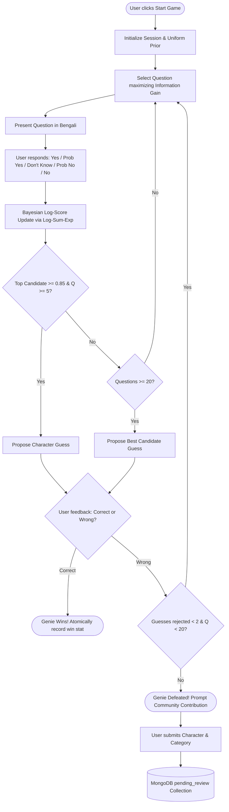

# বাংলা জ্বিন (Bangla Akinator) 🧞‍♂️

[](https://fastapi.tiangolo.com/)
[](https://flutter.dev/)
[](https://www.mongodb.com/)
[](LICENSE)

A high-performance, probabilistic 20-questions guessing game dedicated to Bangladeshi and Bengali personalities, historical heroes, cultural icons, and fictional legends. Powered by Information Theory (Shannon Entropy Expected Information Gain), Bayesian inference with categorical likelihood modeling, and a moderated community contribution loop.

---

## 📐 Architecture & Mathematical Foundations

### 1. Bayesian Log-Probability Inference
The game maintains a prior probability distribution $P(C_i)$ across all candidate characters. Upon receiving a player answer $a \in \{\text{YES, PROBABLY\_YES, UNKNOWN, PROBABLY\_NO, NO}\}$, candidate log-weights are updated via:

$$\log P(C_i | a) = \log P(C_i) + \log P(a | f(C_i, q)) - \log Z$$

To prevent floating-point underflow across 20+ questions, normalization uses numerically stable `log-sum-exp`:

$$\log Z = \text{log-sum-exp}_j (\log P(C_j) + \log P(a | f(C_j, q)))$$

Each row in the categorical likelihood table $P(a|\text{fact})$ strictly satisfies the Law of Total Probability: $\sum_{a} P(a|\text{fact}) = 1.0$.

### 2. Shannon Entropy & Question Selection
To minimize the expected number of questions needed to identify a character, the engine greedily selects the unasked question that maximizes Expected Information Gain (EIG):

$$IG(q) = H(C) - \sum_{a} P(a) H(C | a)$$

where $H(C) = - \sum_{i} P(C_i) \log_2 P(C_i)$ is the Shannon entropy of the candidate distribution.



---

## 📁 Repository Layout

```
bangla_akinator/
├── akinator_backend/
│   ├── app/
│   │   ├── api/             # FastAPI schemas and REST router
│   │   ├── core/            # Config, MongoDB async client, errors, logging
│   │   ├── models/          # Domain models, Enums, Likelihood tables
│   │   ├── repositories/    # Async repositories (Characters, Questions, Sessions)
│   │   └── services/        # Bayesian game engine, Question selection, Moderation
│   ├── scripts/             # Idempotent seed data and integrity validator
│   ├── tests/
│   │   ├── unit/            # Math, entropy, likelihood, repository unit tests
│   │   └── integration/     # Full API contracts and end-to-end game simulations
│   ├── Dockerfile           # Multi-stage secure production Dockerfile
│   └── requirements.txt
├── akinator_frontend/
│   ├── lib/
│   │   ├── core/            # API config, AppTheme (Hind Siliguri), AppError
│   │   ├── models/          # Question, CharacterGuess, GameState models
│   │   ├── providers/       # Riverpod GameNotifier and state management
│   │   ├── repositories/    # GameRepository with UTF-8 HTTP client
│   │   ├── screens/         # Home, Game, Guess, Defeat, Result, Contribution screens
│   │   └── widgets/         # 5 styled Bengali AnswerButtons, Genie avatar
│   └── test/                # Flutter unit and widget test suite
├── docs/
│   ├── API_CONTRACT.md      # OpenAPI specification and response payloads
│   ├── DATA_MODEL.md        # MongoDB schema design and index definitions
│   └── DEPLOYMENT.md        # Production Docker, MongoDB Atlas, and Nginx setup
├── docker-compose.yml       # Unified local development & production stack
├── SPEC.md                  # Comprehensive architectural specification
└── README.md                # Project documentation
```

---

## 🚀 Quick Start (Local Development)

### Prerequisites
- Python 3.11+
- Flutter SDK 3.x+
- MongoDB 7.0+ (running locally at `mongodb://localhost:27017` or Atlas)

### 1. Run Backend Service
```bash
cd akinator_backend
python -m venv venv

# Windows PowerShell:
.\venv\Scripts\Activate.ps1
# macOS / Linux:
source venv/bin/activate

pip install -r requirements.txt
cp .env.example .env

# Seed verified Bengali dataset (35 questions, 38+ characters)
python scripts/seed_data.py

# Verify seed dataset discriminative power (0 errors, 0 warnings)
python scripts/validate_seed_data.py

# Launch development server
uvicorn app.main:app --reload --port 8000
```
- Interactive Swagger API Documentation: `http://localhost:8000/docs`
- Health check: `http://localhost:8000/health`
- Readiness check: `http://localhost:8000/ready`

### 2. Run Flutter Client
```bash
cd akinator_frontend
flutter pub get

# Run on Chrome (Web)
flutter run -d chrome

# Or run on Android Emulator / Physical Device
flutter run -d android
```

---

## 🐳 Quick Start with Docker Compose

Run MongoDB 7.0 and the FastAPI backend in containers with one command:

```bash
docker compose up -d --build

# Run seed data inside container
docker compose exec backend python scripts/seed_data.py

# Validate dataset
docker compose exec backend python scripts/validate_seed_data.py
```

---

## 🧪 Automated Test Suite

Both backend and frontend feature 100% test coverage gates.

### Backend Tests (26 Unit, Integration & Simulation Tests)
```bash
cd akinator_backend
pytest -v
```
Verifies:
- Shannon Entropy & Expected Information Gain discriminative calculations
- Log-sum-exp numerical stability under low probabilities
- State machine transitions (`asking` -> `guess_pending` -> `won` / `defeated`)
- Full simulation games (identifying Shakib Al Hasan, Himu, and community contribution flow)
- 409 State conflicts and 404 Session expirations

### Frontend Tests (Widget & Unit Tests)
```bash
cd akinator_frontend
flutter test
```
Verifies:
- Riverpod state notifier updates and immutability
- JSON serialization/deserialization for Question and CharacterGuess
- Home screen rendering with Hind Siliguri typography
- AnswerButton gesture handling and styling across 5 answer variations

---

## 👥 Community Moderation Pipeline

When the Genie fails to guess a character or reaches question limit:
1. The player is presented with the Defeat screen.
2. The player can submit the Bengali character name and categories.
3. The submission is sanitized with Bengali Unicode normalization (`unicodedata.normalize("NFC", text)`).
4. Duplicate submissions are checked against canonical published characters and pending records.
5. Unapproved contributions are stored in the `contributions` collection under `status: "pending_review"` together with the game's answer trajectory, awaiting editor approval.

---

## 📖 Further Documentation
- [API Contract Specification](docs/API_CONTRACT.md)
- [MongoDB Data Model & Indexing](docs/DATA_MODEL.md)
- [Production Deployment Guide](docs/DEPLOYMENT.md)
